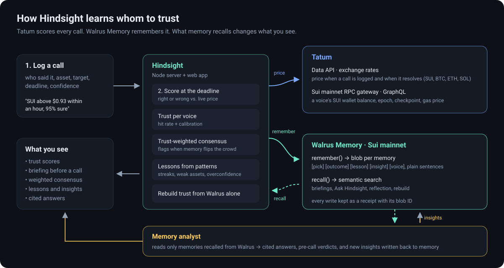

# Hindsight

**The pick journal that remembers who was right.**


Everyone has voices they listen to on markets: a desk analyst, a loud account on X, an uncle on WhatsApp, their own gut. Nobody keeps score. Hindsight does.

You log a call ("SUI closes above $0.90 within an hour, 80% sure"), Hindsight scores it against live prices from **Tatum** when the deadline passes, and writes every call, outcome and lesson to **Walrus Memory** on Sui mainnet. Over time it learns whom to trust, and that knowledge changes what the app shows you.

> Total Recall hackathon (Tatum x Walrus), **Track 01: Markets & Sports Prediction**.

- **Demo video:** https://automationbot24x7.github.io/hindsight/hindsight-demo.mp4
- **Blog post:** https://automationbot24x7.github.io/hindsight/blog.html
- **Hosted demo (read-only snapshot of the live journal):** https://automationbot24x7.github.io/hindsight/
- **Verify any memory on Walrus mainnet:** every receipt in the app links to its blob on [Walruscan](https://walruscan.com/mainnet) (size, Sui object, certification and SEAL encryption transactions).
- **All Walrus write receipts (blob IDs):** [docs/receipts.json](docs/receipts.json)



## What memory changes in the product

| Without memory | With Walrus Memory |
|---|---|
| Every call looks equally credible | Each voice carries a **trust score** learned from past outcomes |
| A new call is just a form | Before you log, Hindsight shows a **briefing** recalled from Walrus: this voice's record on this asset and the most relevant past calls |
| The crowd view is a headcount | **Trust-weighted consensus**: a loud, always-wrong voice counts for less, and the panel flags when memory flips the crowd's view |
| Patterns go unnoticed | **Lessons** are written to memory when patterns appear: losing streaks, weak assets, overconfident high-conviction calls, poor calibration |
| History lives in one database | **Rebuild trust from Walrus**: recompute every voice's trust using only what Walrus remembers. The memory is portable; the local cache is disposable |
| You search notes by keyword | **Ask Hindsight** runs semantic recall over everything it has learned ("who keeps getting SUI wrong?") and answers in plain language, citing the recalled memories |
| Notes never get smarter | **Reflection**: every few outcomes Hindsight reads its own memories back, finds cross-voice patterns and writes `[hindsight:insight]` memories, which later briefings recall |

## How it uses Tatum

- **Data API, exchange rates**: `GET /v4/data/rate/symbol?symbol=SUI&basePair=USD` prices every call when it is logged and again when it resolves (SUI, BTC, ETH, SOL; cached for 60 s to save credits).
- **Sui mainnet RPC gateway** (`sui-mainnet.gateway.tatum.io/graphql`, Sui's GraphQL RPC, since Sui deprecated JSON-RPC):
  - **Skin in the game**: a voice can link a Sui wallet; Hindsight reads its SUI balance on mainnet and shows it next to their record.
  - **Network line**: current epoch, checkpoint and reference gas price.

## How it uses Walrus Memory

- SDK: `@mysten-incubation/memwal`, managed mainnet relayer (`https://relayer.memory.walrus.xyz`), namespace `hindsight`.
- Memory types written as plain sentences, so semantic recall works and humans can read them:
  - `[hindsight:voice]` a new voice is tracked (and its Sui wallet)
  - `[hindsight:pick]` the call, confidence, price when called and reasoning
  - `[hindsight:outcome]` right or wrong, closing price, the voice's updated record and trust
  - `[hindsight:lesson]` patterns worth remembering (rule-based)
  - `[hindsight:insight]` patterns found by reflecting over recalled memories
- `recall()` powers the pre-call briefing, Ask Hindsight, reflection and the rebuild; `listNamespaces()` powers the live memory counter.
- The memory analyst (`server/analyst.js`) only ever sees memories recalled from Walrus for that request, numbered, and must cite them. It returns structured JSON (answer + cited numbers, verdict + tone, insights + cited numbers). It has a daily spend cap and is optional.
- Writes go through a paced queue (one every ~13 s) to stay inside the relayer's per-key rate limit, with retries on rate-limit responses. Every successful write is kept as a receipt with its Walrus **blob ID** and shown in the UI.

## The learning loop

```
log call ──► Tatum price ──► [pick] memory
                                   │
deadline ──► Tatum price ──► outcome ──► trust update ──► [outcome] memory
                                                     └──► pattern? ──► [lesson] memory
next call ──► recall(voice, asset) ──► briefing + trust-weighted consensus
```

Trust = 0.7 × Bayesian hit rate (Laplace prior) + 0.4 × (calibration − 0.25), where calibration is 1 − Brier score, so confident misses cost more than hesitant ones.

Consensus counts one vote per voice (their latest open call on that asset). The crowd view is a plain headcount; the weighted view multiplies each vote by trust × stated confidence × evidence, where evidence = (n + 1) / (n + 3) for n scored calls, so a voice with no record cannot outweigh one with a proven record.

## Run it

Requires Node.js 22+.

```bash
git clone https://github.com/Automationbot24x7/hindsight && cd hindsight
npm install
cp .env.example .env   # fill in your keys
npm start              # http://localhost:8787
```

`.env` values:

| Key | Where to get it |
|---|---|
| `TATUM_API_KEY` | [dashboard.tatum.io](https://dashboard.tatum.io) → API Keys → Mainnet key (free plan) |
| `MEMWAL_KEY` | [memory.walrus.xyz](https://memory.walrus.xyz/dashboard) → Delegate keys → private key (shown once) |
| `MEMWAL_ACCOUNT_ID` | Walrus Memory dashboard → SDK credentials → Account ID |
| `ANTHROPIC_API_KEY` | Optional. Turns on the memory analyst (cited answers, verdicts, reflection). Without it Ask lists the recalled memories. |

Without Walrus keys the app runs on the SDK's in-memory mock so you can try the UI.

Optional: `node tools/seed-demo.mjs` logs a demo set of calls from four voices with different habits (short deadlines resolve within minutes, longer ones stay open for the consensus panel). The calls are real: they are priced and scored with live Tatum data.

## Project layout

```
server/index.js      HTTP API + static files (no framework)
server/hindsight.js  calls, outcomes, trust, lessons, rebuild-from-memory
server/memory.js     Walrus Memory client, paced write queue, receipts
server/tatum.js      Tatum rates + Sui GraphQL RPC
server/analyst.js    memory analyst: cited answers, verdicts, reflections
public/              single-page UI
tools/seed-demo.mjs  demo data
tools/export-snapshot.mjs  static snapshot for GitHub Pages
```

## Hackathon details

- Walrus Memory account ID: `0x9b425a99c4630cc35361ee65de90fc12d70ec32e1648a423874b5a63f35b3643`
- Agent (delegate public key): `0f5ab4098a2c418a6fafa536c5c1011ab00ecb3cfcdf8b142d1b264523b68ca7`
- Namespace: `hindsight`

## License

MIT
